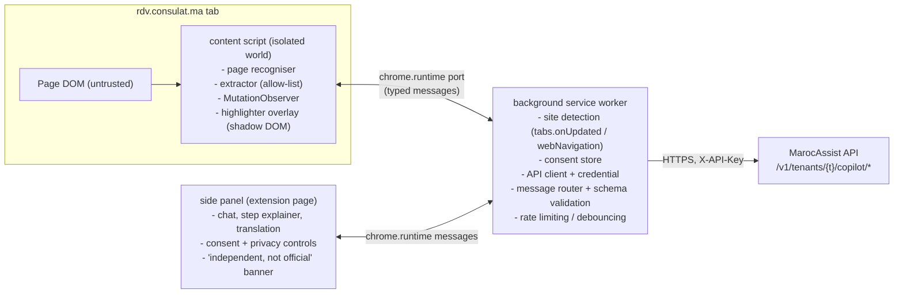

# MarocAssist Copilot — browser extension architecture

Status: Phase 0 proposal, 2026-11-19. Chrome platform facts are marked
VERIFIED where they were confirmed against Chrome documentation; everything
else is a RECOMMENDATION.

## 1. Purpose and non-goals

The Copilot is a Chrome side panel that explains, translates and guides while
the user operates the official website (initially `https://rdv.consulat.ma`)
themselves.

**Non-goals (binding):** no form submission, no clicking on the user's
behalf, no slot selection, no polling or refresh, no CAPTCHA handling, no
network requests to RDV, no reading of passwords, cookies, storage or hidden
inputs, no imitation of the official site's branding. See
`../research/RDV_INTEGRATION_ASSESSMENT.md` §4.

Chrome Web Store fit: "single purpose" = *contextual guidance for Moroccan
consular websites*. Prohibited-products policy forbids facilitating
unauthorised access (e.g. circumventing login restrictions) and deceptive or
impersonating products (VERIFIED, Chrome Web Store program policies, read
2026-11-19; 2026 Limited Use tightening to "strictly necessary", enforced from
2026-08-01, VERIFIED).

## 2. Platform facts (VERIFIED, developer.chrome.com, 2026-11-19)

- Manifest V3; no remotely hosted code; logic must be in the package.
- `chrome.sidePanel`: Chrome 114+, `"sidePanel"` permission and
  `side_panel.default_path`; `setOptions({tabId, path, enabled})` enables
  the panel per tab; `setPanelBehavior({openPanelOnActionClick: true})`;
  `sidePanel.open()` from Chrome 116, user gesture required.
- `activeTab` grants temporary access after a user gesture, without an install
  warning; broad host patterns trigger warnings.

## 3. Components



| Component | Responsibilities | Must never |
|---|---|---|
| Content script | Recognise page/step; extract an allow-listed semantic snapshot; observe DOM changes; draw highlights and tooltips in a closed shadow root; report validation messages | Read `input[type=password]` or `[type=hidden]` values, `document.cookie`, `localStorage`/`sessionStorage`, iframes of other origins, CAPTCHA widgets; dispatch events, set values, submit, navigate; inject `<script>`; execute strings from the page or the backend |
| Service worker | Single network client; holds the credential; enforces consent and per-site enablement; validates every message against a schema; debounces snapshots; enforces size caps | Forward raw HTML; accept messages from web pages other than the app origin (pairing); log content |
| Side panel | UI, language selection (NL default; FR/AR/EN), conversation, step guide, "what the AI received" preview, consent toggles | Render model output as HTML (text/markdown subset only, sanitised); call the API directly (goes through the service worker) |

## 4. Manifest (proposal)

```jsonc
{
  "manifest_version": 3,
  "name": "MarocAssist Copilot (independent assistant)",
  "minimum_chrome_version": "116",
  "permissions": ["sidePanel", "storage", "activeTab", "scripting"],
  "host_permissions": ["https://app.<domain>/*"],
  "optional_host_permissions": ["https://rdv.consulat.ma/*"],
  "side_panel": { "default_path": "sidepanel.html" },
  "background": { "service_worker": "background.js", "type": "module" },
  "externally_connectable": { "matches": ["https://app.<domain>/*"] },
  "content_security_policy": { "extension_pages": "script-src 'self'; object-src 'none'" }
}
```

Notes:

- `rdv.consulat.ma` is an **optional** host permission, requested at runtime
  when the user first enables the Copilot for that site. That makes consent
  explicit at browser level and avoids an install-time warning. The content
  script is registered with `chrome.scripting.registerContentScripts` only
  after the permission is granted. (Alternative: `activeTab` only, user clicks
  each time; worse UX for multi-page flows. Decision D-11.)
- The backend host permission lets the service worker call the API without
  CORS (SaaS-OS ships no CORS by design).
- No `webRequest`, `cookies`, `tabs` (beyond what `activeTab` gives),
  `debugger`, `<all_urls>` or `declarativeNetRequest`.

## 5. Authentication: extension pairing (RECOMMENDATION)

SaaS-OS offers no device flow or token exchange, and its session secret is
never returned to clients (VERIFIED). The extension therefore uses a
product-owned pairing flow built on SaaS-OS service-account API keys:

```mermaid
sequenceDiagram
  participant SP as Side panel
  participant SW as Service worker
  participant Tab as App tab (https://app.<domain>)
  participant API as MarocAssist API
  SP->>SW: user clicks "Connect account"
  SW->>Tab: chrome.tabs.create(app/connect-extension?nonce=N&ext=ID)
  Tab->>API: (logged in via SaaS-OS session) POST /v1/tenants/{t}/copilot/devices {nonce, device_label}
  API->>API: create/reuse service account "copilot-device-<id>", role copilot_client,<br/>create_service_account_api_key, audit record
  API-->>Tab: {api_key (shown once), device_id, tenant_id}
  Tab->>SW: chrome.runtime.sendMessage(EXTENSION_ID, {nonce, api_key, tenant_id, device_id})
  SW->>SW: verify sender.origin == app origin and nonce matches; store in chrome.storage.local
  SW->>API: GET /v1/tenants/{t}/copilot/whoami (X-API-Key)
  API-->>SW: ok (plan, limits, language)
```

Properties:

- Least privilege: the key's service account holds only `copilot_client`
  (no documents, profile or billing). SaaS-OS keys have no per-key scopes, so
  scope comes from the role (VERIFIED: keys carry their owner's permissions).
- The key reaches only the user's tenant, is rate-limited per key, and every
  call is attributed to the service account; `extension_devices` maps it to
  the user for display and audit.
- Revocation from the web app; rotation every 90 days via the same pairing
  call; immediate revocation on logout-everywhere and account deletion.
- `chrome.storage.local` is not encrypted at rest; the residual risk (malware
  on the device) is accepted and documented — the key cannot read documents.
- To verify in Phase 2 spike (NOT VERIFIED): that a service-account
  `ServiceAccountCaller` can hold a tenant role with `ai.inference:run` and
  call `run_inference` in a personal tenant end-to-end.

## 6. Page understanding: DOM-first

### 6.1 Snapshot schema (sent to backend only with consent)

```jsonc
{
  "site": "rdv.consulat.ma",
  "rules_version": "2026.12.1",
  "url_pattern": "/{lang}/rendez-vous/service",   // path template, query removed
  "page_id": "rdv.select_service",                // recognised step or "unknown"
  "lang": "fr",
  "title": "...",
  "headings": ["..."],
  "instructions": ["visible help text, truncated"],
  "fields": [
    { "ref": "f3", "label": "Type de service", "type": "select", "required": true,
      "options": ["Passeport", "CNIE", "..."], "state": "empty|filled|invalid",
      "error": "Ce champ est obligatoire" }
  ],
  "buttons": [{ "ref": "b1", "text": "Suivant", "disabled": false }],
  "alerts": ["visible error/notice banners"],
  "captcha_present": true                          // flag only, never content
}
```

- Field **values are excluded** by default; only `state` is sent. Options of
  `<select>` elements are sent (they are site vocabulary, not user data),
  except when the rules mark a select as personal (e.g. a list of the user's
  family members).
- Text is collected only from visible, allow-listed regions; capped
  (e.g. 8 KB per snapshot); whitespace normalised.
- Patterns that look like identifiers (CNIE, passport numbers, dates of birth,
  emails, phone numbers, IBANs) are masked client-side before sending
  (`[ID]`, `[DATE]`), then masked again server-side (defence in depth).
- `ref`s are opaque per-snapshot handles; the backend can ask the side panel
  to highlight `f3` but cannot address arbitrary selectors.

### 6.2 Dynamic content

- `MutationObserver` on the main content root (`childList`, `subtree`,
  `attributes` limited to `class`, `aria-invalid`, `disabled`, `hidden`),
  debounced (e.g. 400 ms), plus `popstate`/history patching detection and
  `chrome.webNavigation`-free URL checks via `tabs.onUpdated` for SPA routing.
- A new snapshot is produced only when the structural hash changes; it is sent
  to the backend only when the user asks something or opens the step
  explainer (no continuous streaming of page state).

### 6.3 Page recognition rules (data, shipped in the package)

```yaml
- id: rdv.select_service
  match:
    host: rdv.consulat.ma
    path: "^/(fr|ar|en)/.*service"          # placeholder; real rules authored from owner-captured pages
    requires: ["select[name*=service]", "h1,h2:contains-any(Service|خدمة)"]
  fields:
    - ref_hint: "select[name*=service]"
      personal: false
  guidance_key: rdv.select_service
```

Rules are versioned, unit-tested against sanitised fixture pages, and
updated through extension releases. The backend also knows rule ids to fetch
step guidance from the knowledge base (`guidance_key`).

### 6.4 Vision (later, optional)

SaaS-OS refuses image content parts (VERIFIED). Screenshot analysis is
therefore out of MVP scope. If later approved it must: be user-triggered per
capture, use `chrome.tabs.captureVisibleTab` only, blur input fields and
CAPTCHA regions before upload, show a preview, and run through a governed
vision path (requires an upstream SaaS-OS change or an explicit decision).

## 7. Copilot features → mechanisms

| # | Capability | Mechanism | Phase |
|---|---|---|---|
| 1 | Detect supported websites | URL host allow-list in service worker; side panel enabled per tab via `sidePanel.setOptions` | 5 |
| 2 | Understand current page | Recognition rules → `page_id`; snapshot | 5 |
| 3 | Detect navigation | `tabs.onUpdated` + content-script history hooks | 5 |
| 4 | Recognise forms/fields | Extractor: label resolution (`<label for>`, `aria-labelledby`, nearest text) | 5 |
| 5 | Dynamic content | MutationObserver, debounced structural hash | 5 |
| 6 | Explain current step | Knowledge guidance for `page_id` + LLM explanation in NL | 5 |
| 7 | Translate FR/AR → NL | Visible text segments → assistant translate use case; cached per rules version and text hash (non-personal) | 6 (basic in 5) |
| 8 | Answer questions about the page | Snapshot + question → `copilot.answer` use case | 5 |
| 9 | Highlight elements | Backend returns `refs`; content script draws overlay in shadow DOM; never focuses or changes inputs | 6 |
| 10 | Explain validation errors | Alerts + field `error` text → explanation; never auto-correct | 6 |
| 11 | Guide the workflow | Step graph from knowledge base; progress indicator | 6 |
| 12 | Voice | Later; depends on streaming/audio upstream (issue #206) | 10 |

## 8. Consent and privacy UX

- First run: plain-language explanation (NL), what is read, what is sent,
  what is never read; per-site enablement switch; link to privacy notice.
- Per-request: a "Share this page with MarocAssist" action is required before
  any snapshot leaves the browser (default). Users may opt in to "share
  automatically on this site while the panel is open".
- "What did MarocAssist see?" preview shows the exact JSON that was sent.
- Pause button stops observation instantly; closing the panel stops it.
- Persistent banner: "MarocAssist is independent and not affiliated with the
  Moroccan government. You submit forms yourself."

## 9. Security controls (extension)

- Strict extension CSP; no `eval`, no remote code; dependencies pinned and
  audited; minimal third-party libraries.
- Message validation with schemas (e.g. zod) on every boundary; reject
  unknown fields.
- `externally_connectable` limited to the app origin; pairing nonce check.
- Model output rendered as text or a strict markdown subset, links only to an
  allow-list (official domains, MarocAssist), opened with
  `rel="noopener noreferrer"`.
- No logging of snapshot content in the extension; telemetry limited to
  counters and `page_id`s, opt-in.
- Store listing and privacy disclosures kept in the repo and reviewed with
  each release.

## 10. Testing

| Level | What | Tool |
|---|---|---|
| Unit | Extractor, masking, rule matching against fixture HTML (sanitised captures) | Vitest + jsdom |
| Contract | Message schemas, API types generated from OpenAPI | Vitest |
| Security | Canary tests: fixture pages with fake passport numbers, passwords, hidden CSRF inputs, cookies → assert absent from every outbound payload | Vitest + Playwright |
| Prompt injection | Fixture pages containing injected instructions → assert backend treats them as data (see `AI_ARCHITECTURE.md` §7) | Backend eval suite |
| E2E | Load unpacked extension in Chromium against a **local mock site** replicating RDV structure (never the real site in CI) | Playwright (persistent context) |
| Permissions | Manifest snapshot test: fails on any new permission | Vitest |
