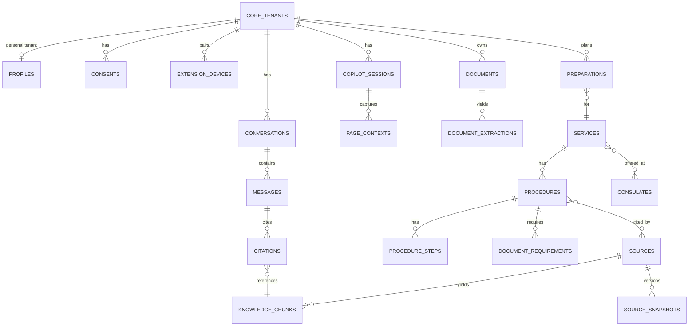

# Data architecture

Status: Phase 0 proposal, 2026-11-19 (RECOMMENDATION). Follows SaaS-OS
conventions (VERIFIED): one PostgreSQL 16 database; SaaS-OS tables in its own
schemas with Alembic version table `alembic_version_saas_os`; MarocAssist
tables in schema `marocassist` with its own Alembic history; product code
uses `saas_os.infra.db` primitives only.

## 1. Data classes

| Class | Examples | Storage rule |
|---|---|---|
| Global public | Services, procedures, consulates, knowledge chunks, translations cache | Non-tenant tables; the app role has `SELECT` only; written only by the publishing loader under the migrations role at deploy (Phase 3, ADR-0007) |
| Tenant personal | Profile, preferences, conversations, page contexts, preparations | `tenant_id` FK to `core.tenants.id`, RLS via `tenant_rls_statements`, purge participant |
| Tenant highly sensitive | Identity numbers, documents, extractions | As above + field/envelope encryption; separate retention |
| Platform | Users, tenants, sessions, billing, audit, AI attempts | SaaS-OS owned; never written directly by MarocAssist |

## 2. Logical model

## 3. Key tables (selected columns)

**Global**

- `services(id, key, names jsonb{nl,fr,ar,en}, category, active)`
- `procedures(id, service_id, consulate_scope, version, status{draft,review,published,retired}, summary jsonb, fees jsonb, published_at, review_due_at)`
- `procedure_steps(id, procedure_id, ordinal, title jsonb, body jsonb, rdv_page_id nullable)`
- `document_requirements(id, procedure_id, doc_type, conditions jsonb, mandatory)`
- `consulates(id, name, country, city, address, contact jsonb, source_id)`
- `sources(...)`: superseded in Phase 3 by `knowledge_sources`, with `licence`, `allowed_use` and the rights classes R1-R6 (`docs/phase-3/CONTENT_RIGHTS_AND_PROVENANCE.md` sections 2-3).
- No `source_snapshots` with page text: until legal question Q-K2 is answered, only the URL, title, hash and editor notes are kept, never a copy of the content.
- `knowledge_chunks(id, source_id nullable, procedure_id nullable, language, text, tsv, status, version)`
- `review_tasks(id, kind, target_id, reason, assigned_to, status)`
- `translation_cache(key_hash, target_lang, text, rules_version, created_at)`
- `site_rules(version, site, published_at)` (mirror of extension rules for guidance lookup)

**Tenant (RLS)**

- `profiles(tenant_id, display_name, preferred_language, residence_country, consulate_id, birth_date_enc nullable, nationality_flags)`
- `identity_numbers(tenant_id, kind{cnie,passport}, value_enc, last4, expires_on)` — only if a feature needs it; not in MVP
- `consents(tenant_id, purpose, version, granted, granted_at, source{web,extension})`
- `conversations(tenant_id, id, channel{web,copilot}, title, created_at, last_activity_at)`
- `messages(tenant_id, id, conversation_id, role, text, language, template_version, inference_ref, created_at)`
- `citations(tenant_id, message_id, chunk_id, source_id, label)`
- `extension_devices(tenant_id, id, service_account_id, label, created_by_user_id, last_seen_at, revoked_at)`
- `copilot_sessions(tenant_id, id, device_id, site, started_at, ended_at)`
- `page_contexts(tenant_id, id, session_id, page_id, rules_version, snapshot jsonb (sanitised), created_at)`
- `preparations(tenant_id, id, service_id, consulate_id, checklist jsonb, status, target_date)`
- `documents(tenant_id, id, doc_type, storage_key, size, sha256, dek_wrapped, kek_version, uploaded_at, expires_on, retention_until)`
- `document_extractions(tenant_id, document_id, engine, fields_enc jsonb, confidence, created_at)`
- `export_requests(tenant_id, id, requested_by, status, artifact_key, expires_at)`

## 4. Lifecycle and retention (defaults, to confirm — Q-P6)

| Data | Default retention | Mechanism |
|---|---|---|
| `page_contexts` | 30 days | Product system job (daily), batch delete, audit count row |
| Conversations/messages | 12 months after last activity; user delete anytime | Product job |
| Documents | Until user deletes; reminder at expiry; auto-delete after 24 months inactivity with notice | Product job + crypto-shredding of DEK |
| Translation cache | 180 days | Product job |
| Source snapshots | Latest 5 per source | Product job |
| SaaS-OS AI attempts | 100 days (SaaS-OS job, opt-in) | `AI_ATTEMPT_RETENTION_ENABLED=true` |
| Sessions, billing events | SaaS-OS timers | SaaS-OS |
| Audit logs | Immutable (SaaS-OS) | Legal question Q-P6 |

Account deletion: (1) revoke extension keys, (2) cancel subscription,
(3) mark personal tenant deleted, (4) purge (product participants delete or
crypto-shred all rows/blobs), (5) `erase-user` for identity links. Steps 3–5
are SaaS-OS operator operations today; MarocAssist wraps them in an
operator-approved job with an SLA (GDPR: one month).

## 5. Migrations

- `python -m marocassist.migrate`: run SaaS-OS core migrations
  (`run_core_migrations`), register permissions, then product migrations, as
  in the consumer scaffold.
- Every product migration: schema `marocassist`, RLS statements for tenant
  tables, explicit grants to the app role, reversible where feasible, tested
  in CI against PostgreSQL 16 with the real role setup.
- Global tables: grant `SELECT` to the app role only. Writes happen only
  through the publishing loader, under the migrations role at deploy time,
  with an audit row in the editorial tenant (Phase 3; correction C-3 in
  `docs/phase-3/PHASE3_ARCHITECTURE_REPORT.md`).

## 6. Search index

`knowledge_chunks.tsv` generated per language configuration; GIN index.
Implementation depends on decision D-07 (SaaS-OS exports no FTS
primitives). Arabic text-search configuration and `pg_trgm` availability in
the PostgreSQL image must be verified in Phase 3.

## 7. Object storage layout

`s3://<bucket>/tenants/<tenant_id>/documents/<document_id>/<version>` —
ciphertext only, opaque names, private bucket, versioning on, lifecycle rules
aligned with retention; separate backup bucket per SaaS-OS backup pattern.
