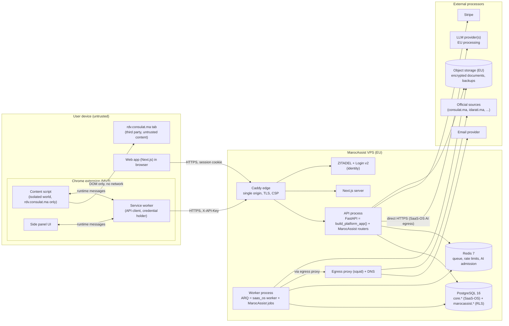
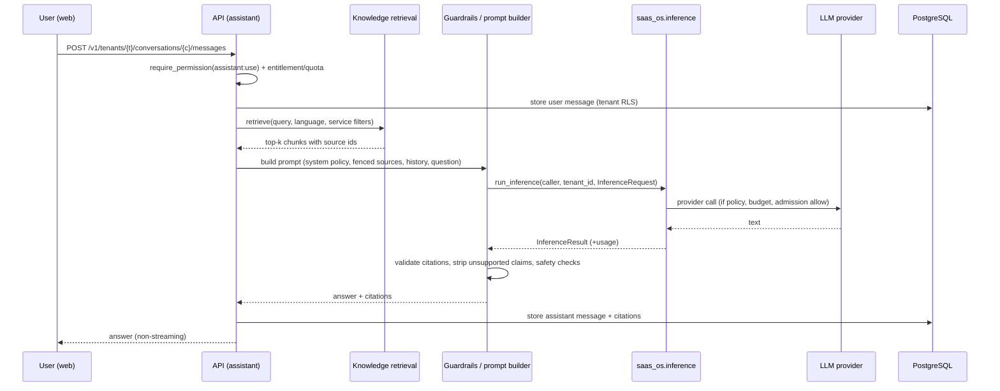
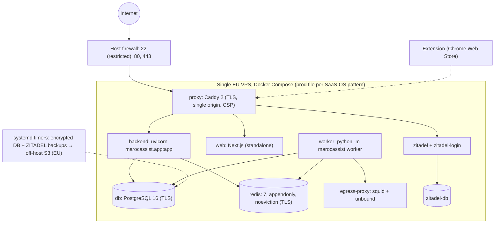

# System architecture

Status: Phase 0 proposal, 2026-11-19. Everything in this document is a
**RECOMMENDATION** unless marked VERIFIED. Facts about SaaS-OS come from
`SAAS_OS_INTEGRATION.md`.

## 1. Architectural style: modular monolith

**Decision (recommended): one backend deployable (API process + worker process
from the same codebase), one web frontend, one browser extension.** No
microservices.

Reasons:

- SaaS-OS is a library that a product composes into *one* FastAPI application
  and *one* ARQ worker (VERIFIED). Splitting MarocAssist into services would
  duplicate the ingress chain, tenancy, RLS sessions and audit per service.
- Expected load is modest (a niche B2C audience); the expensive work is LLM
  calls, which are I/O-bound and already governed by SaaS-OS admission
  control.
- One deployable keeps the security perimeter small, which matters given ID
  documents and personal data.

Module boundaries are enforced inside the monolith with import-linter
contracts (the same tool SaaS-OS uses), so a module can be extracted later if
evidence demands it (likely candidates: OCR worker, knowledge fetcher).

## 2. Containers and trust boundaries



### Trust boundaries

| ID | Boundary | What crosses it | Controls |
|---|---|---|---|
| TB1 | RDV page → content script | Untrusted DOM text, labels, error messages | Isolated world; allow-listed extraction; secrets never read (password, hidden inputs, cookies, storage); output is data, never instructions |
| TB2 | Content script → service worker | Sanitised page snapshot | Message schema validation; sender check (`sender.id`, tab URL) |
| TB3 | Extension → backend | Snapshot + user question, extension credential | User consent per site; TLS; `X-API-Key` of a narrow service account; per-key rate limits; size limits; server-side re-validation and redaction |
| TB4 | Browser web app → backend | Session cookie, user input | SaaS-OS session auth; ADR-0044 same-origin check; CSP; route policies |
| TB5 | Backend → LLM provider | Prompt text with classification | `saas_os.inference` policy gates, destination policy, budgets; no secrets or identifiers in prompts; untrusted content fenced |
| TB6 | Backend → database | All persistent data | Restricted app role, RLS per tenant, field encryption for identity numbers |
| TB7 | Backend → object storage | Encrypted document blobs | Client-side envelope encryption; per-tenant key derivation; private bucket |
| TB8 | Platform operator → admin API | Operator actions | SaaS-OS platform authority, MFA, platform audit |
| TB9 | Worker → official websites | Fetch of public pages | `StrictEgressClient`/egress proxy, allow-listed hosts, low rate, robots.txt |
| TB10 | Developer/CI → production | Code, migrations | Reviewed PRs, CI gates, pinned dependencies, no secrets in CI |

## 3. Module map (backend, Python package `marocassist`)

| Module | Responsibility | Depends on (SaaS-OS) | Owns tables |
|---|---|---|---|
| `marocassist.app` | Composition: `build_platform_app()`, router registration, purge participants, CSP | `saas_os.api.platform` | — |
| `marocassist.accounts` | Onboarding (personal tenant), profile, preferences, consents, account deletion/export orchestration | `core.tenancy`, `core.rbac`, `core.identity`, `core.audit_log` | `profiles`, `preferences`, `consents` |
| `marocassist.catalogue` | Consular services catalogue, procedures, required documents, consulates | `infra.db` | `services`, `procedures`, `procedure_steps`, `document_requirements`, `consulates` (global) |
| `marocassist.knowledge` | Sources, snapshots, provenance, freshness, retrieval index, editorial workflow | `infra.db`, `infra.jobs`, `infra.egress` | `sources`, `source_snapshots`, `knowledge_chunks`, `review_tasks` (global) |
| `marocassist.assistant` | Conversations, AI orchestration (prompt building, grounding, citations, guardrails), translation | `saas_os.inference`, `inference.settings`, `core.usage` | `conversations`, `messages`, `citations` (tenant) |
| `marocassist.copilot` | Extension pairing, page-context intake, site recognition rules, copilot sessions | `core.api_keys`, `core.identity` (service accounts), `saas_os.inference` | `extension_devices`, `copilot_sessions`, `page_contexts` (tenant) |
| `marocassist.documents` | Uploads, encryption, OCR, classification, completeness checks, retention | `core.crypto`, `infra.jobs` | `documents`, `document_extractions` (tenant) |
| `marocassist.appointments` | Appointment preparation checklists (no booking) | `catalogue` | `preparations` (tenant) |
| `marocassist.notifications` | Templates (NL/FR/AR/EN), notification list | `core.notifications`, `core.email` | `notification_prefs` (tenant) |
| `marocassist.billing` | Plans, entitlements mapping, Stripe wiring | `core.billing`, `api.v1.billing` | — (SaaS-OS tables) |
| `marocassist.admin` | Editorial and operator UI APIs | `api.platform_admin`, `core.rbac` | — |
| `marocassist.integrations` | Ports for external systems: `rdv` (interface only, no implementation), `storage`, `ocr`, `official_sources` | `infra.egress` | — |
| `marocassist.privacy` | Redaction, PII detectors, export builder, retention jobs | `core.audit_log`, `infra.jobs` | `export_requests` (tenant) |

Dependency rule (enforced by import-linter in MarocAssist):

```
app -> (all feature modules)
feature modules -> privacy, integrations, shared
assistant, copilot -> knowledge (read-only retrieval API), catalogue
no feature module imports another feature module's internals (public module API only)
integrations never import feature modules
nothing imports saas_os.control_plane.*; nothing imports sqlalchemy/psycopg directly
  (single documented exception decided in D-07)
```

## 4. Component responsibility matrix

| Concern | Web app | Backend API | Worker | Extension | SaaS-OS | External |
|---|---|---|---|---|---|---|
| Login / registration / MFA | Redirects | `/auth/*` (SaaS-OS) | — | Pairing only | OIDC, sessions | ZITADEL |
| Tenant isolation | — | Routes use `context.tenant_id` | Jobs use `TenantJobContext` | — | RLS, ingress chain | — |
| Consular catalogue | Browse, search | Read APIs | Freshness jobs | Contextual lookups | — | Official sites |
| AI answers | Chat UI | Orchestration, grounding | — | Side-panel chat | Governed inference | LLM provider |
| Page understanding | — | Validate + redact snapshot | — | DOM extraction, MutationObserver, highlighting | — | — |
| Documents | Upload UI | Upload/download APIs | Encrypt, OCR, classify | — | Field encryption, jobs | Object storage |
| Notifications | Inbox | List API | Send | — | Outbox, email | Email provider |
| Billing | Plans page | Billing routers | Stripe events | Shows plan limits | Billing, entitlements | Stripe |
| Audit | Activity page | Records in-transaction | Records | — | Audit log, digests | Log store |
| Admin | Editorial/operator UI | Admin routes | — | — | Platform authority | — |

## 5. Data flow (end-to-end, assistant question)



## 6. Authentication and authorisation flows

### 6.1 Web app

1. Browser → `GET /auth/login` (SaaS-OS) → ZITADEL Login v2 (same origin) →
   `/auth/callback` sets the session cookie (VERIFIED behaviour).
2. Web app calls `GET /v1/me/onboarding` (MarocAssist). If the user has no
   personal tenant, `POST /v1/onboarding` creates it with
   `SystemCaller(SystemAuthority.PROVISIONING)`, assigns the owner role,
   records consents, and returns the tenant id. Idempotent per user.
3. Every subsequent call uses `/v1/tenants/{tenant_id}/...` with
   `require_permission`. Mutations are cookie-authenticated and same-origin
   (ADR-0044).

### 6.2 Extension (detail in `BROWSER_COPILOT_ARCHITECTURE.md` §5)

1. User installs the extension and clicks "Connect" in the side panel; it
   opens `https://<app>/connect-extension` in a normal tab.
2. Signed-in user approves. The backend creates (or reuses) a per-device
   **service account** in the user's personal tenant, holding only the
   `copilot_client` role, and issues a `sok_` API key for it.
3. The web page hands the key to the extension through
   `chrome.runtime.sendMessage(EXTENSION_ID, ...)` (the extension declares
   `externally_connectable` for the app origin only). The key is never shown
   to the user.
4. The service worker stores it in `chrome.storage.local` and sends it as
   `X-API-Key` on calls to routes declared with `api_key=True`.
5. Revocation: the web app's "Connected devices" page revokes the key
   (`revoke_service_account_api_key`); the extension shows "disconnected".

### 6.3 Roles (initial)

| Role (per personal tenant) | Holder | Permissions (product + SaaS-OS) |
|---|---|---|
| `owner` | The user | All `marocassist.*` permissions in their tenant, `ai.policy:manage`, `ai.policy:read`, `ai.usage:read`, `ai.budget:manage`, `ai.inference:run`, membership, billing |
| `copilot_client` | Extension service account | `copilot:assist`, `copilot:session_write`, `catalogue:read`, `ai.inference:run` — nothing else (no documents, no profile, no billing) |
| `helper` (later) | Invited relative | Read catalogue/preparations, chat; no documents unless granted |

Staff: editorial work happens in a dedicated **editorial tenant** whose
members hold `knowledge:edit`/`knowledge:publish`; platform administration
uses SaaS-OS platform operators with MFA. Staff never get tenant roles in
customer tenants; customer data access uses SaaS-OS's tenant-approved support
access.

## 7. Integration ports (external systems)

```
marocassist/integrations/
  rdv/            RdvIntegration protocol; only NullRdvIntegration exists.
                  An official/partner adapter is added only with written authorisation.
  storage/        ObjectStorage protocol; S3CompatibleStorage, LocalFsStorage (dev/test)
  ocr/            OcrEngine protocol; TesseractOcr (self-hosted) first
  official_sources/  SourceFetcher; uses StrictEgressClient, host allow-list, robots.txt
```

Each port has a fake for tests. No port calls RDV.

## 8. Deployment architecture



- Environments: `development` (Compose, Mailpit, local ZITADEL, fake AI
  provider), `staging` (same topology, real providers in test mode),
  `production`.
- Single origin `https://app.<domain>`: `/auth/*`, `/v1/*`, `/healthz`,
  `/readyz` → backend; ZITADEL Login v2 paths → identity; everything else →
  web (SaaS-OS ADR-0024 pattern via `saas-os-edge-config` for local dev).
- The marketing site, if any, lives on a separate origin with no cookies.
- Releases: container images built in CI, tagged with the git SHA; deploy is a
  manual, approved step (`docker compose pull && up -d` after migrations).

## 9. Proposed repository structure

> **Phase 1 update (2026-11-19, ADR-0002):** the backend lives in `backend/`
> (`backend/pyproject.toml`, `backend/uv.lock`, `backend/src/marocassist/`),
> as the Phase 1 brief prescribes; browser end-to-end checks live in `e2e/`.
> The rest of the structure below is unchanged. The implemented layout is
> described in `docs/phase-1/PHASE1_REPORT.md` §3.

```
marocassist/
  README.md
  CLAUDE.md                     # agent/dev conventions (Phase 1)
  pyproject.toml                # package "marocassist", pinned saas-os SHA
  constraints.txt / uv.lock     # see decision D-02
  alembic.ini
  src/marocassist/              # backend modules (section 3)
    migrations/                 # product Alembic history (schema "marocassist")
  tests/
    unit/  integration/  architecture/  contract/  security/
  web/                          # Next.js app (TypeScript), i18n nl/fr/ar/en, RTL
  extension/                    # Chrome MV3 (TypeScript, Vite build), side panel
    src/content/ src/background/ src/sidepanel/ src/shared/
    rules/                      # versioned site-recognition rules (data)
    tests/                      # vitest + Playwright extension tests
  packages/contracts/           # OpenAPI-generated TS types shared by web + extension
  knowledge/                    # curated content source files (YAML/Markdown) + schema
  deploy/                       # compose files, Caddyfile, systemd units
  scripts/                      # check-backend.sh, check-web.sh, check-extension.sh, check-all.sh
  docs/
    architecture/ roadmap/ research/ adr/ upstream/ runbooks/
  .github/workflows/ci.yml
```

## 10. Key quality attributes

| Attribute | Target (MVP) | Mechanism |
|---|---|---|
| Tenant isolation | Zero cross-tenant reads | RLS, isolation tests per table (SaaS-OS checklist §13) |
| Privacy | No identity numbers, passwords, cookies or tokens ever reach an AI provider | Extension extraction allow-list + server redaction + tests with canary values |
| Assistant groundedness | Every procedural claim cites a source | Citation validator; evaluation set |
| Availability | Single VPS, best effort; RPO 24 h, RTO 8 h (to confirm) | SaaS-OS backups, restore drill |
| Answer latency | p95 < 15 s non-streaming (to validate) | Short answers, small context, provider choice |
| Extension resilience | Unknown pages degrade gracefully | Fingerprint rules, fallback help |
