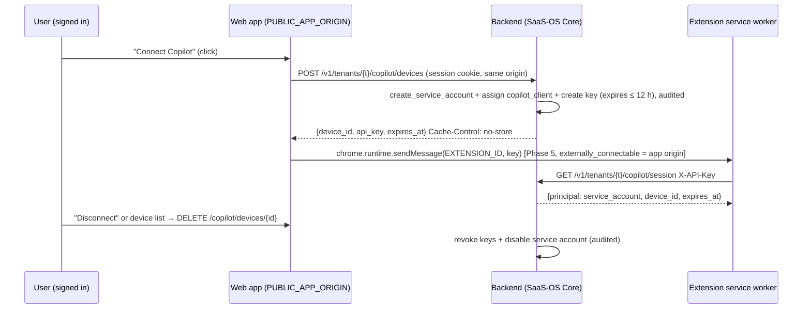

# Work package E — Extension authentication

Status: Phase 1, 2026-11-19. Backend part implemented and tested; the
extension-side pairing (key delivery and storage) is designed here and is
built in Phase 5. Classification: VERIFIED (tested or read at the pin),
NOT VERIFIED, RECOMMENDATION.

## 1. Question

Can the Copilot browser extension call the MarocAssist API with a credential
that is short-lived, revocable, minimally scoped and tenant-bound, using only
SaaS-OS v0.15.0 identity (no second identity system)?

**Answer: yes, with one known limit** (bearer key, not sender-constrained;
§6). A permanent or broad key is not used.

## 2. Why not the browser session

| Option | Result | Evidence |
|---|---|---|
| Reuse the web session cookie from the extension | Rejected. Cookie mutations from `chrome-extension://…` are refused by SaaS-OS (ADR-0044); reads would need the cookie outside the web origin | `test_cookie_mutation_from_extension_origin_is_refused` (403) — VERIFIED |
| Give the extension the session secret | Rejected. SaaS-OS never returns it to frontend code; it carries the user's full authority for 12 h | `saas_os/api/auth/routes.py` — VERIFIED |
| OAuth device flow / token exchange | Not available in SaaS-OS v0.15.0 | Source search at the pin — VERIFIED absent |
| **Service-account API key per device** | **Chosen** | §3 |

## 3. Design (implemented in the backend)

One paired browser = one SaaS-OS **service account** in the user's personal
tenant, with role `copilot_client` = only `marocassist.copilot:use`, and one
**API key** (`sok_…`) with `expires_at` ≤ 12 h.

## 4. Assessment against the brief

| Property | Result | Evidence |
|---|---|---|
| Credential lifetime | `expires_at = now + MAROCASSIST_COPILOT_KEY_TTL_SECONDS` (default 8 h; 5 min–12 h; ceiling in code). Expired key → 401 | `test_paired_key_is_short_lived_and_reaches_only_the_copilot_route` (TTL within bounds), `test_expired_device_key_is_refused`, `test_copilot_key_ttl_is_bounded` — VERIFIED |
| Revocability | Device revoke = revoke every key + disable the service account; SaaS-OS re-reads both on every request, so the next call fails | `test_revoked_device_key_stops_working_immediately` — VERIFIED |
| Rotation | No self-rotation: SaaS-OS lets a service account rotate a key only with tenant-wide `api_key:rotate`, which would let a stolen key mint keys (`saas_os/core/api_keys/service.py:704`). Renewal = new pairing from the signed-in web app; the old device is revoked | Source — VERIFIED; flow RECOMMENDATION |
| Scope | Role holds only `marocassist.copilot:use`; only `GET /copilot/session` opts in to keys (`api_key=True`); SaaS-OS forbids keys on authority-changing permissions | Key gets 401/403 on settings, devices, workspace routes — VERIFIED; `test_only_the_copilot_session_route_accepts_api_keys` |
| Tenant binding | A key reaches only its own tenant | `test_device_key_is_bound_to_its_tenant` — VERIFIED |
| Rate limiting | SaaS-OS limits per key and per tenant in `require_permission`, plus a failed-credential limit | Source and consumer guide §9 — NOT load-tested |
| Audit logging | `service_account.create`, `service_account_role` assignment, `api_key.create`, `api_key.revoke`, `service_account.disable` by Core in the same transaction; denied key validations audited | `test_pairing_and_revocation_are_audited` — VERIFIED (create/disable asserted) |
| Device limit | Max active devices per tenant (default 3) because SaaS-OS does not count service-account keys | `test_device_limit_is_enforced` — VERIFIED |
| Storage in the browser | RECOMMENDATION (Phase 5): `chrome.storage.session` only (memory, cleared when the browser closes; default access level `TRUSTED_CONTEXTS`, so content scripts cannot read it); held by the service worker only; never in a content script, never in `storage.local`, never in the side panel DOM | Not implemented in Phase 1 — NOT VERIFIED |
| Token extraction | A process or extension with access to the browser profile memory can read a bearer key. Impact is bounded: one tenant, `copilot:use` only, ≤ 12 h, revocable from the web app, visible in the device list and audit trail. No profile, document or billing access | Analysis |
| Compromised browser | Same bound as above; malware with control of the browser can also use the live web session, which is broader than the key. Re-pairing is required after 12 h | Analysis |
| Delivery to the extension | RECOMMENDATION (Phase 5): `externally_connectable.matches = [PUBLIC_APP_ORIGIN]`; service worker accepts the key only from that origin and only for a pairing it initiated (nonce). XSS on the web origin would expose a new key, but such XSS already holds the full session; the strict CSP (Phase 2) mitigates both | NOT VERIFIED |

## 5. Not used, and why

- No second identity system, no product-issued JWTs, no custom token table.
- No long-lived key "remember me": a key never outlives 12 h.
- No key in a URL, a query string, the page DOM or a content script.

## 6. Residual risk and upstream proposal

The key is a **bearer** credential: whoever holds it can use it until it
expires or is revoked. SaaS-OS v0.15.0 offers no sender-constrained token.

Upstream proposal U-6 (refined, not submitted; owner decision): a governed
**device credential** minted from a user session — OAuth 2.0 Token Exchange
(RFC 8693) or Device Authorization Grant (RFC 8628) — with a short access
token (≤ 15 min), a refresh token bound to the device by DPoP (RFC 9449),
per-credential scopes, and "last used" metadata. Until then the design above
is the safest option the pin supports.

## 7. Verdict

Acceptable for development and the Phase 5 closed beta, given the controls
in §4. Re-assess when SaaS-OS ships U-6 or before public launch (D-14 pen
test scope).
