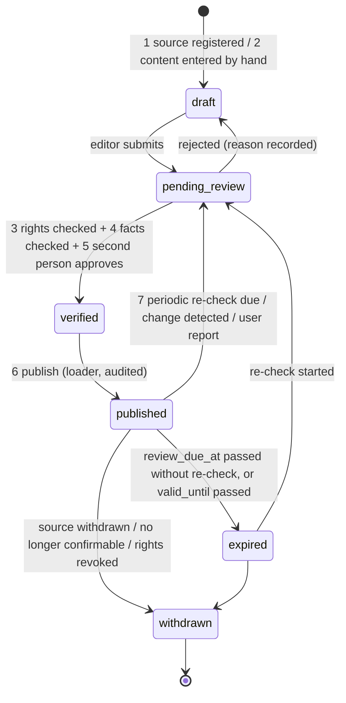

# Content rights and provenance (Phase 3 design proposal)

Status: design approved by the owner (2026-11-20) under the conditions in the
[architecture report](PHASE3_ARCHITECTURE_REPORT.md) §12–13; not implemented.
Related documents: [ADR-0007](../adr/0007-knowledge-search.md),
[search architecture](KNOWLEDGE_SEARCH_ARCHITECTURE.md),
[security review](PHASE3_SECURITY_REVIEW.md),
[official data sources](../research/OFFICIAL_DATA_SOURCES.md) and
[consulates](../product/CONSULATES.md).

## 1. Principles

1. **Refer, do not copy.** MarocAssist explains in its own words and links to
   the official source. The official source remains authoritative, and
   MarocAssist never presents itself as an official source.
2. **No implied permission.** Reachable is not reusable. Without a recorded
   right, the only allowed use is "link and own explanation". This is
   especially relevant because idarati.ma's legal notice reserves reproduction
   (verified in Phase 0).
3. **Every fact is traceable.** Each published fact or explanation points to at
   least one registered source, with the date it was consulted and the date it
   was verified.
4. **Nothing unverified looks current.** Content that is expired, withdrawn or
   unverified is always labelled as such and is never shown as current official
   information.
5. **Humans publish.** No automated path, AI included, publishes content. AI
   may only produce drafts for editors.
6. **No scraping or bulk import.** Content enters only by manual editorial
   entry. Automated change detection is a separate decision (§6.3) and is off
   by default.

## 2. Source register

One row per source: a web page, a PDF, a form or an official letter.

| Field | Type / values | Notes |
|---|---|---|
| `source_id` | stable key, e.g. `src-ma-consulat-passport-fr` | Never reused |
| `title` | text | Name of the source as the publisher titles it |
| `official_url` | HTTPS URL | On the domain allow-list; displayed and clickable |
| `publisher` | text, plus `publisher_key` | Owning organisation, e.g. MAECAMRE, Rijksoverheid |
| `source_type` | `official` / `government` / `consulate` / `secondary` / `internal` | See §2.1 |
| `country` | ISO 3166-1, e.g. `MA`, `NL` | Country of the publisher |
| `geo_scope` | `global` / `country:NL` / `consulate:<code>` / `region:<code>` | What the content applies to |
| `consulate_codes` | list | Empty means not consulate-specific |
| `language` | BCP 47 (`fr`, `ar`, `nl`, `en`) | Language of the source itself |
| `consulted_at` | date | When an editor opened the source |
| `verified_at` | date | When an editor confirmed the facts that rely on it |
| `review_due_at` | date | Derived from the review policy (§5.2); can be overridden with a reason |
| `valid_until` | date, optional | When the source states a validity (fees for a given year, temporary measures) |
| `licence` | `unknown` / `all_rights_reserved` / `open_licence:<id>` / `written_permission:<ref>` | Evidence reference required for anything other than `unknown` |
| `allowed_use` | set of `link`, `cite_fact`, `summary`, `short_quote`, `verbatim`, `redistribute_document` | §3; derived from the licence and capped by policy |
| `rights_evidence_ref` | text, optional | Where the permission letter or terms snapshot is filed (private, not in a public repo) |
| `owner_reviewer` | editor id (pseudonymous user id) | Who is responsible for checking it |
| `status` | `draft` / `pending_review` / `verified` / `expired` / `withdrawn` | §5 |
| `content_hash` | sha256, optional | Of the last verified version, for change detection |
| `notes` | text | Editorial only; never shown to users; no personal data |

### 2.1 Source types and trust ranking

| Type | Example | Rank | Can support an "official" claim? |
|---|---|---|---|
| `consulate` | Website of a Moroccan consulate-general | 1 | Yes, for its own consulate |
| `official` | Moroccan ministry or national portal (consulat.ma, idarati.ma) | 1 | Yes |
| `government` | Dutch government (rijksoverheid.nl, IND, municipalities) | 2 | Yes, for NL-side facts; Moroccan facts only as secondary corroboration |
| `secondary` | News, NGOs, directories | 3 | **Never**; context only, always labelled |
| `internal` | MarocAssist's own explanation | — | **Never**; it is our wording, not a source of facts |

The answer layer uses the rank (§7). A fact whose only support is a
`secondary` or `internal` source cannot be published as a fact.

## 3. Content rights classes

Every content item (§4) carries one rights class. Publishing checks that the
class is allowed by the `allowed_use` of every source it relies on.

| Class | What it is | Default allowed? | Conditions |
|---|---|---|---|
| R1 Own explanation | Text written by MarocAssist editors | Yes | Must not be a close paraphrase of a protected text; facts inside it still need R2 citations |
| R2 Cited fact | Discrete fact (fee, required document, address, deadline) with a source link | Yes | Source `verified`; fact typed and structured (§4.2); link always shown |
| R3 Short summary | Brief summary of an official page in our own words | Yes | Not a substitute for the page; always ends with "read the official page" and a link |
| R4 Verbatim text | Literal text from a source | **No**, unless the source has `short_quote` or `verbatim` | Quote marks plus attribution. A short quote needs legal confirmation (Q-K1) of the quotation right that applies. Never long passages. |
| R5 Third-party document or form | PDF form, official template | **No hosting** | Link to the official location only. Store a hash and title for change detection; never re-host unless `redistribute_document` is backed by written permission. |
| R6 Permission-only content | Anything whose reuse needs explicit permission (databases, images, logos, bulk lists) | **No** | Only with `written_permission:<ref>`; the evidence reference is mandatory |

Logos and government emblems are never used (Phase 0: no government look).

## 4. Content model (conceptual)

- **Knowledge item:** a unit an editor publishes, for example
  "Passport renewal — explanation".
  - Fields: `item_id`, `kind`, `rights_class`, `consulate_scope`,
    `country_scope`, `topic_keys`, `version` and `status`.
  - Per language: title, body and keywords. Each language has its own review
    status, so a French text cannot ride on the Dutch approval.
- **Fact:** a typed, structured value, for example `fee.passport_renewal.adult`
  = 300 MAD for consulate `*`.
  - Fields: `fact_key`, `value`, `unit`, `scope`, `valid_from`,
    `valid_until`, `source_ids[]`, `verified_at` and `status`.
  - Facts are answered from structured data, never from free text.
- **Citation link:** links an item or fact to a source, with an optional
  locator (section heading or page number of a PDF).
- **Consulate record:** see `KNOWLEDGE_SEARCH_ARCHITECTURE.md` §6. Each
  attribute group has its own source and verification date.

## 5. Lifecycle

### 5.1 Gates

| Step | Gate | Who |
|---|---|---|
| 3 Rights checked | Rights class allowed by every source's `allowed_use`; evidence reference present for R4–R6 | Editor |
| 4 Facts checked | Each fact matches the source on `verified_at`; locator filled | Editor |
| 5 Human approval | **Four-eyes**: the approver is an independent second person, not the author (enforced in code). Owner decision 2026-11-20: this reviewer is **not yet appointed**; technical development continues, but no real content is approved or published until one is. | Reviewer role |
| 6 Publication | Loader validates schema, rights and PII scan; it is audited | System, triggered by the reviewer |

### 5.2 Review periods

The owner fixed the periods for fees, procedures and own explanations on
2026-11-20. The other rows are proposed defaults.

| Content | `review_due_at` after verification |
|---|---|
| Fees and tariffs | 90 days, or `valid_until` if sooner |
| Required documents, procedures, forms | 180 days |
| Consulate address and contact details | 180 days |
| Opening hours (only once verified) | 90 days |
| Own explanations without facts | 365 days |

A known change, such as an announced fee change, a new form or a new
procedure, triggers an earlier re-check, whatever the period. Expired
content is never presented as current information.

### 5.3 Situations

| Situation | Behaviour |
|---|---|
| **Outdated** (`review_due_at` passed) | The item is `expired` automatically. Status is computed when it is read, so no job has to run for it. Answers still cite it only with an "Not recently verified — check the official source" notice and **never state its facts as current** (§7). A review task is opened. |
| **Conflicting sources** | Two verified sources give different values for the same `fact_key` and scope: the fact is flagged `conflict`. The answer shows both values with their sources and dates and states the conflict; no single value is presented as true. The conflict appears on the editor dashboard. |
| **Changed forms** | A new hash for an R5 document (manually observed, or from optional change detection) moves dependent items to `pending_review`. The answer links to the official location and warns that the form may have changed. |
| **Changed fees** | The fact is versioned: the new value gets `valid_from`, and the old one keeps `valid_until`. History is kept for audit. Until the re-check is done, the fee shows "under review". |
| **New consular procedure** | Editors create a new item. Old items that it replaces get `withdrawn` with a pointer to the successor. |
| **No longer confirmable** (source gone, 404, unreachable for 30 days) | `withdrawn` if the source is confirmed removed. Otherwise `expired`, with an editor task. Unreachability alone is not proof of removal, because Moroccan sites block some networks (Phase 0, R-03). |

### 5.4 Withdrawal and corrections

Withdrawal is immediate (loader publish of status `withdrawn`). Answers already
given are not altered, but conversation views show "this source has since been
withdrawn" next to their citations (§7).

## 6. Collection and change detection

### 6.1 Manual entry only (Phase 3)

Editors read the official page in a normal browser and enter facts and
explanations by hand. If an editor uses AI help (`marocassist.knowledge.draft`,
classification `none`), it only produces a draft from text the editor pasted.
The draft is marked `ai_assisted` and goes through the same gates.

### 6.2 Evidence

Editors record `consulted_at`, `verified_at` and a locator. Private snapshots
(page text or PDF) as evidence are legal question **Q-K2**. Until it is
answered, store **only** the URL, title, hash and the editor's notes, and no
copy of the content.

### 6.3 Automated change detection (later, opt-in, owner + legal decision)

- Only after Q-K2 is answered, and only for sources whose terms and robots.txt
  allow it.
- Settings: low rate (at most 1 request per source per day), an honest
  User-Agent, `StrictEgressClient`, a domain allow-list, and **no**
  origin-disguising proxies.
- It stores a hash only and never feeds the content to search or AI. A change
  produces a review task, never an automatic content update.
- This is not scraping for content. It is still automated access, so it is
  **off until the owner decides** (decision P3-D4).

## 7. Answer provenance

Every answer that uses knowledge carries **source cards**, built by the server
from the database and never from the model's text:

| Card field | Value |
|---|---|
| Label | `[1]`, `[2]` … matching the citations in the text |
| Title, publisher | From the source register |
| Badge | `Official` (rank 1–2, verified) / `Secondary` / `MarocAssist explanation` |
| Scope | "Applies to: Consulate-General Rotterdam (location Schiedam)" / "All consulates" / "Netherlands" |
| Last verified | `verified_at` date |
| Status notice | None if current; "Not recently verified" if expired; "Conflicting information" if conflict; "Withdrawn" when viewed later |
| Link | `official_url`; opens the original source in a new tab (`rel="noopener noreferrer"`) |

Rules:

- The model may only cite ids from the provided set. The post-processor removes
  any other citation and drops any URL that is not on the allow-list (§8 of the
  search architecture document).
- If the answer contains a procedural claim without a citation, the answer is
  rejected or downgraded to "I cannot confirm this; see the official page".
- An answer about a consulate-scoped fact while the consulate is unknown leads
  to a clarifying question, not a guess.
- Expired, conflicting and secondary-only content is labelled in the answer
  text **and** on the card.

## 8. Untrusted content

All external content (web pages, PDFs, document metadata) is untrusted
**data**. This also applies to documents that editors have approved (owner
decision 2026-11-20): approval never turns content into instructions for the
AI. Controls are in `PHASE3_SECURITY_REVIEW.md` §3. In short:

- Raw external text never reaches the answer model. Only editor-approved
  knowledge does.
- Editor drafts from pasted text are sanitised (bidi and zero-width
  characters, markup, hidden text) and are reviewed by a human.

## 9. Personal data in knowledge

- Knowledge contains no user data.
- Public office contact details (switchboard, generic email) are allowed;
  names and direct contact details of officials are not stored.
- The loader runs a PII scan (email or phone patterns outside the contact
  fields, identifier formats such as CNIE and BSN) and refuses on a hit.

## 10. Open legal questions

These are carried over from Phase 0 and are still open:

- **Q-K1:** paraphrase and quotation rights under Moroccan law.
- **Q-K2:** private snapshots.
- **Q-K3:** disclaimers.
- **Q-K4:** data.gov.ma licence.

Until legal review, the owner decided (2026-11-20) that only these are
allowed: own explanations (R1), cited facts (R2) and short summaries in our
own words (R3). Verbatim reuse (R4) and hosted forms (R5) are not allowed
without demonstrable permission.

New:

- **Q-K5:** reuse terms of rijksoverheid.nl pages for consulate addresses.
  Facts are likely not protected; confirm.
- **Q-K6:** whether Moroccan law 09-08 applies to MarocAssist's processing,
  given an EU controller and data subjects who are Moroccan nationals
  (Phase 0 R-13).
