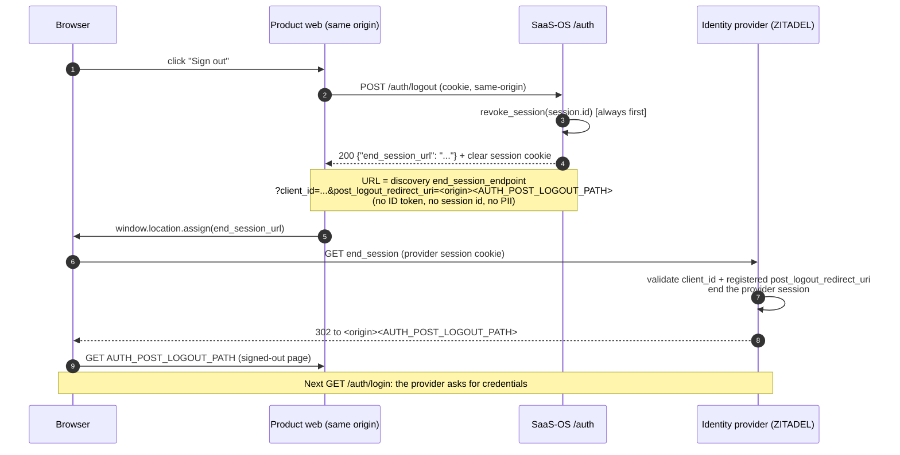

# U-4: RP-initiated logout for SaaS-OS

Status: **proposal, not implemented**. Date: 2026-11-20. Author: MarocAssist
(consumer of SaaS-OS v0.15.0, pinned at `cdede956dd884fc816b234f1b546ce3b983b4efc`).
It closes MarocAssist finding P2-F1, a production blocker. The SaaS-OS owner
decides whether and how to implement it. No SaaS-OS code or repository has been
changed, and no upstream PR has been opened.

## 1. Problem

`POST /auth/logout` in SaaS-OS revokes the platform session and clears the
session cookie. It does not end the session at the identity provider (ZITADEL).
On the same browser, "sign in" then goes through the provider without asking for
a password.

This was reproduced locally on 2026-11-20 against ZITADEL v4.19.5 (login v1),
with a throwaway `example.test` user and the Phase 2 dev stack:

| Step | Observed |
|---|---|
| Sign in, then `POST /auth/logout` | `/auth/me` returns 401 (platform session revoked) |
| `GET /auth/login` right after | Back on `http://localhost:8080/dashboard` without any provider page: **silent sign-in** |

On a shared computer (library, family PC, a consulate waiting room), the next
person can therefore enter the previous user's account. Severity is Medium
(P2-F1).

## 2. Current SaaS-OS implementation (v0.15.0)

- `saas_os/api/auth/routes.py`
  - `POST /auth/logout` calls `revoke_session(session.id)`, clears the cookie and
    returns 204. It requires a valid session. When the credential is the cookie,
    the request must come from the application's own origin (ADR-0044).
  - It logs `auth_logout` with the user and session ids only.
- `saas_os/core/identity/provider.py`
  - The `IdentityProvider` Protocol and the module docstring list "provider-side
    logout" explicitly as out of scope. This proposal is therefore a deliberate
    widening of the identity boundary, which needs an owner decision upstream.
  - Discovery reads only `jwks_uri`, `authorization_endpoint` and
    `token_endpoint`. `end_session_endpoint` is not read.
- The ID token is **never persisted**. In `callback()`,
  `exchange_authorization_code` returns it, `validate_id_token` checks it, and it
  is then discarded. `core.sessions` stores only a SHA-256 hash of the platform
  secret, `verified_email`, `multi_factor` and `provider_authenticated_at`.
- `AuthHttpConfig` has a fixed, same-origin `post_login_path`. There is no
  post-logout setting.
- `saas_os/infra/local_identity/zitadel_bootstrap.py` registers a public PKCE
  client with `redirectUris` only. It registers no `postLogoutRedirectUris`.

Local ZITADEL discovery (`/.well-known/openid-configuration`) advertises:

- `end_session_endpoint`: `http://zitadel.localhost:8081/oidc/v1/end_session`
- `backchannel_logout_supported`: `true`
- No `frontchannel_logout_supported` and no `check_session_iframe`.

## 3. Desired functionality

After the user signs out, the next sign-in on the same browser must ask for
credentials again at the provider. More specifically:

1. The platform session is revoked first, always, exactly as today.
2. The browser is then sent to the provider's `end_session_endpoint`, taken from
   discovery and never hard-coded.
3. The provider returns the browser to one fixed, registered, same-origin
   post-logout URL.
4. The feature is opt-in and off by default, so existing consumers see no change.

### Local evidence that this closes the gap

| Probe (2026-11-20, local ZITADEL) | Result |
|---|---|
| After `POST /auth/logout`, browser opens `GET /oidc/v1/end_session` (no parameters) | Lands on ZITADEL `/ui/login/logout/done`, HTTP 200 |
| `GET /auth/login` afterwards | Shows the ZITADEL login page (`/ui/login/login`), **not silent**. Choosing the listed account shows a password field. |
| `end_session?client_id=<app>&post_logout_redirect_uri=https://evil.example/` | **400**, `{"error":"invalid_request","error_description":"post_logout_redirect_uri invalid"}` |
| `end_session?client_id=<app>&post_logout_redirect_uri=http://localhost:8080/` (not registered) | **400**, same error |
| `end_session?post_logout_redirect_uri=...` with neither `client_id` nor `id_token_hint` | The parameter is ignored; lands on `/logout/done` (no redirect) |

The probe script is local only and not committed; it used a throwaway user at
`example.test` and Mailpit. Two observations matter for the design:

- ZITADEL enforces post-logout URI registration itself.
- After logout, the ZITADEL account chooser still shows the previous account
  (name and email, marked "Uitgelogd"). The password is required, but the
  account name stays visible on a shared computer (§6, residual risk R-4).

## 4. OIDC flow



When the feature is off, or the provider advertises no `end_session_endpoint`,
steps 4–9 do not happen. The response is the 204 it is today.

## 5. API design

The aim is the smallest extension of existing interfaces: no new route, no new
table and no stored token.

### 5.1 Configuration (`AuthHttpConfig`, non-secret, from the environment)

| Variable | Default | Rule |
|---|---|---|
| `AUTH_PROVIDER_LOGOUT` | `false` | Boolean. Off keeps today's behaviour byte for byte. |
| `AUTH_POST_LOGOUT_PATH` | `/` | Same validation as `AUTH_POST_LOGIN_PATH`: a same-origin absolute path. The absolute URL is derived from `PUBLIC_APP_ORIGIN`. With the flag on and no `PUBLIC_APP_ORIGIN`, configuration fails closed (`AuthConfigurationError`). |

A browser-supplied `next=` or redirect parameter is deliberately not supported,
for the same reason as on login.

### 5.2 Discovery (`provider.py`)

- `OIDCFlowEndpoints` gains `end_session_endpoint: str | None`.
- It is read with the existing `_usable_endpoint` rule (same scheme rule, no
  redirect following, issuer check). It is `None` when absent.

### 5.3 Provider boundary

The `IdentityProvider` Protocol stays unchanged, because adding a method would
break every existing fake or implementation that passes the
`@runtime_checkable` check. Instead there is a separate, optional Protocol:

```python
@runtime_checkable
class SupportsProviderLogout(Protocol):
    def build_end_session_url(self, *, post_logout_redirect_uri: str) -> str | None:
        """Pure, no I/O. None when the provider has no end_session_endpoint.
        Sends client_id and post_logout_redirect_uri only."""
```

`OIDCIdentityProvider` implements it. The auth route checks for it with
`isinstance(...)`.

### 5.4 `POST /auth/logout`

- **Unchanged:** authentication, origin check, `revoke_session`, cookie clearing
  and the `auth_logout` log line.
- **Flag off, or provider without logout support:** `204 No Content`, as today.
- **Flag on:** `200 {"end_session_url": "<url>"}` with `Cache-Control: no-store`.
  - The local session is already revoked before the URL is built, so a failure
    here can never leave the platform session alive.
  - If the URL cannot be built (discovery failure), the route returns 204, logs
    `auth_provider_logout_unavailable`, and the frontend shows "close the
    browser". Local logout is never blocked by the provider.

The OpenAPI schema gains an optional 200 response model `ProviderLogout`.

### 5.5 Parameters: what is sent and why

| Parameter | Decision |
|---|---|
| `client_id` | **Sent.** OIDC RP-Initiated Logout 1.0 lets the RP send it instead of `id_token_hint`. ZITADEL documents that `client_id` or `id_token_hint` must be present to look up the registered URIs, and the probe confirmed it validates them. |
| `post_logout_redirect_uri` | **Sent.** It is the one derived URL, and it must be registered at the provider (§5.6). |
| `id_token_hint` | **Not sent** in this proposal. It would need SaaS-OS to keep the raw ID token (which carries email and name claims) for the whole session. That adds personal data and a bearer-like artefact at rest, which SaaS-OS avoids today (§6). It is an option only if a provider requires it (§7). |
| `state` | **Not sent.** It only carries RP state across the redirect. The landing page is fixed and needs none, and nothing security-relevant depends on it: the session is already revoked, and an attacker who forges the return gains only a signed-out page. If the owner wants it anyway, it can be a random value bound to a short-lived HttpOnly cookie and checked at the landing path, which means a callback route. Not recommended. |
| `logout_hint`, `ui_locales` | Not sent (not needed; `logout_hint` would be personal data). |

### 5.6 Redirect registration

- `zitadel_bootstrap.py` registers `postLogoutRedirectUris:
  [<origin><AUTH_POST_LOGOUT_PATH>]` on create. An existing app gets the same
  idempotent update pattern as `login_version_update_request`.
- In production, the operator registers the same single URI in the provider
  console. The deployment runbook documents this.

## 6. Security analysis

| Requirement | How it is met |
|---|---|
| Only registered logout redirects | The URL is derived server-side from `PUBLIC_APP_ORIGIN` and a validated path, so the browser cannot choose it. The provider also rejects any unregistered URI with 400 (local probe). This gives two independent checks. |
| No open redirect | There is no request parameter that influences the target, and the response is built from configuration only. A test asserts that a request carrying `post_logout_redirect_uri`, `next` or a `redirect` query or body is ignored. |
| Secure session termination | `revoke_session` runs before anything else and does not depend on the provider. The cookie is cleared in the same response. The existing revoked-session tests stay. |
| No ID token in URLs or logs | No ID token is kept, so none can leak. The URL contains only `client_id` (public) and the registered URI. A log-capture test asserts no token-shaped value appears. |
| No parallel identity architecture | The proposal adds one optional Protocol method and one discovery field. Sessions stay in `saas_os.core.identity.sessions`, and no product code talks to the provider. |
| Compatible with existing integrations | The feature is opt-in, the default is unchanged (204), and the `IdentityProvider` Protocol is untouched (§7). |
| Logout CSRF | The route stays `POST` with the existing same-origin rule. A third-party page could link to the provider's `end_session` directly; that is a property of the provider, not of this change, and at worst signs the user out. |

### Residual risks

| ID | Risk | Mitigation |
|---|---|---|
| R-1 | The user closes the tab before the provider redirect completes, so the provider session survives. | UI text "close the browser on a shared computer"; back-channel logout (U-5, future). |
| R-2 | ZITADEL's `end_session` without `id_token_hint` logs out all users of this user agent (ZITADEL docs: "current implementation"). | Acceptable, and arguably desirable on a shared computer. Document it. |
| R-3 | Other applications on the same provider keep their own tokens; a community report says refresh tokens of other clients stay valid. | Out of scope: MarocAssist is the only client and uses no refresh tokens. |
| R-4 | The ZITADEL account chooser still shows the previous account's name and email after logout (observed). | Password required; remove-account option or provider setting to investigate (NOT TESTED). |
| R-5 | A community thread reports ZITADEL ignoring `post_logout_redirect_uri` without `id_token_hint`. | Must be verified in the integration test (§9, T-9). If confirmed, the fallback is the provider's own logout page plus a link back, still without storing the token. |

## 7. Backward compatibility

| Consumer | Effect |
|---|---|
| Existing SaaS-OS consumers (flag unset) | None. Same status (204), body, cookies and logs. |
| Custom `IdentityProvider` implementations or fakes | None. The Protocol is unchanged, and logout support is detected with `isinstance(..., SupportsProviderLogout)`. |
| Providers without `end_session_endpoint` | The flag on still yields 204, plus a warning log line at startup and at logout. |
| Database | No migration. No new column; the ID token is still not stored. |
| OpenAPI | An additive 200 response. Clients that check `response.ok` keep working; clients that check `status === 204` must accept 200 when they opt in. |

Rejected alternative: storing the ID token per session (encrypted) to send
`id_token_hint`. It needs a migration, a key, retention rules and erasure
coverage, and it puts email and name claims at rest. Only revisit this if a
supported provider rejects `client_id`-only logout.

## 8. Migration proposal

**SaaS-OS (upstream, owner decision)**
1. ADR "Provider-side logout (RP-initiated)" amending the boundary in
   `provider.py` and ADR-0023.
2. The implementation in §5, the bootstrap change and the tests in §9.
3. A minor release (feature off by default).

**MarocAssist (after the release)**
1. Bump the pin to the new SaaS-OS commit and verify the lock.
2. Set `AUTH_PROVIDER_LOGOUT=true` and `AUTH_POST_LOGOUT_PATH=/` in Compose and
   `.env.example`. Re-run the bootstrap or register the URI.
3. Web `signOut`: on a 200 with `end_session_url`, call
   `window.location.assign(url)`; on a 204, keep today's behaviour and show the
   "close the browser" hint.
4. In `e2e/signup.e2e.mjs`, turn the P2-F1 INFO line into a PASS/FAIL check:
   "sign-in after sign-out asks for credentials".
5. Close P2-F1 only after that check passes on GitHub CI and in the E2E run.

## 9. Test plan

| # | Level | Test |
|---|---|---|
| T-1 | Unit | Discovery reads `end_session_endpoint` with the same scheme and issuer rules; absent gives `None`; a malformed value gives a config error |
| T-2 | Unit | `build_end_session_url` contains exactly `client_id` and `post_logout_redirect_uri`, URL-encoded, and no other parameter |
| T-3 | Unit | Config: the flag on without `PUBLIC_APP_ORIGIN` fails; `AUTH_POST_LOGOUT_PATH` rejects `//evil`, `https://evil`, relative paths, CR/LF |
| T-4 | Route | Flag off gives 204 and an identical response to v0.15.0 (snapshot) |
| T-5 | Route | Flag on gives 200 with the URL; the session is revoked **before** the URL is built (fault injection in the builder still leaves the session revoked) |
| T-6 | Route | Request-supplied `post_logout_redirect_uri`, `next` or `redirect` are ignored |
| T-7 | Route | Logs: no `id_token`, `code`, cookie value or email in any log record during logout |
| T-8 | Route | A fake provider without `SupportsProviderLogout` gives 204 plus `auth_provider_logout_unavailable` |
| T-9 | Integration (real ZITADEL) | `client_id` plus the registered URI redirects back to the app (verifies R-5); an unregistered URI gives 400 |
| T-10 | E2E | Sign in, sign out, then `/auth/login` shows provider credentials, not a silent sign-in (P2-F1 regression test) |
| T-11 | E2E | The existing logout tests (old cookie dead, same-origin rule) stay green |

## 10. Acceptance criteria

1. With the flag on, a sign-in after sign-out on the same browser requires
   credentials at the provider (T-10 green on CI).
2. With the flag off, behaviour is identical to v0.15.0 (T-4).
3. The browser cannot influence the logout target; only the registered URI is
   accepted, and the provider rejects others (T-6, T-9).
4. No ID token is stored, sent or logged (T-2, T-7; schema diff shows no new
   column).
5. The platform session is revoked even when the provider is unreachable (T-5,
   T-8).
6. The `IdentityProvider` Protocol is unchanged; existing fakes still pass.
7. An ADR is accepted by the SaaS-OS owner.

## 11. Dependencies

- A SaaS-OS owner decision to widen the identity boundary ("provider-side
  logout" is currently listed as out of scope).
- The provider must advertise `end_session_endpoint` (ZITADEL does) and support
  `client_id`-based post-logout redirects. This is documented by ZITADEL but
  still unverified end to end (T-9).
- `PUBLIC_APP_ORIGIN` must be set (ADR-0024). MarocAssist already sets it.
- Production: an operator registers the post-logout URI at the provider.

## 12. Estimated implementation size

| Part | Size (estimate) |
|---|---|
| SaaS-OS code (config, discovery field, Protocol, route, bootstrap) | about 120–180 lines |
| SaaS-OS tests (T-1 … T-9) | about 250–350 lines |
| SaaS-OS ADR and docs | 1 ADR, docstring updates, runbook line |
| MarocAssist adoption (pin, env, web `signOut`, E2E check, docs) | about 40–80 lines |
| Effort | SaaS-OS about 2–3 developer days including review; MarocAssist about 0.5 day after release |

These are estimates, not measurements.

## Future work (not part of U-4)

**U-5: OIDC back-channel logout.** ZITADEL advertises it. It would revoke
platform sessions when the user signs out elsewhere or an administrator ends
their sessions, which covers R-1. It needs a new public endpoint with logout
token validation, so it is a separate proposal.

## Sources

- OpenID Connect RP-Initiated Logout 1.0 (`client_id`, `id_token_hint`,
  `post_logout_redirect_uri`, `state`).
- ZITADEL logout guide: https://zitadel.com/docs/guides/integrate/login/oidc/logout
  ("either the id_token_hint or the client_id"; end_session logs out all users of
  the current user agent; back-channel logout supported).
- Community reports, unverified, to be checked by T-9:
  https://questions.zitadel.com/m/1447492163398013029 and
  https://questions.zitadel.com/m/1483818197328203877
- SaaS-OS v0.15.0 source at the pinned commit: `saas_os/api/auth/routes.py`,
  `saas_os/api/auth/config.py`, `saas_os/core/identity/provider.py`,
  `saas_os/core/identity/models.py`,
  `saas_os/infra/local_identity/zitadel_bootstrap.py`.
